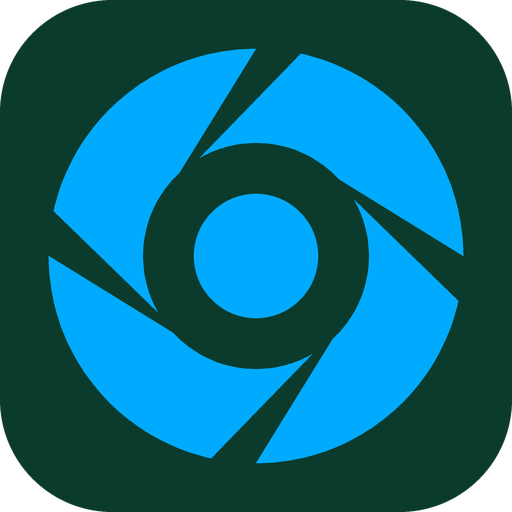

# Flyen DICOM Viewer for Claude

Let Claude look at and control the [Flyen DICOM Viewer](https://flyen.web.app)
open on your Windows computer. Ask about the study on your screen and Claude
can look at the image, move through slices and series, change the window,
switch between 2D, MPR and 3D, measure density (HU) and distances, point at
findings with arrows, and show, measure or run AI organ segmentation.

> **Viewing support only, not for diagnosis.** Claude can be wrong. A qualified
> physician must review the study and make every clinical decision.

## Requirements

- Windows 10 or 11 with **Flyen 1.1 or newer** ([download](https://flyen.web.app)).
- **Node.js 18 or newer** on the computer (`node` on the PATH), used to run the
  plugin's small server in Cowork and Claude Code.
- The plugin works in **Cowork** (when the session runs on your computer) and in
  **Claude Code**. In ordinary Claude Desktop chats, use the Flyen extension for
  Claude Desktop instead: [flyen.web.app/claude.html](https://flyen.web.app/claude.html).

## Setup

1. Install this plugin.
2. In Flyen, open the **AI** menu and switch on
   **Allow Claude Desktop to control Flyen**. Switch it off at any time to stop
   Claude's access.
3. Open a study in Flyen and ask Claude about it, for example
   *"Show me the lungs in the lung window and measure the largest nodule"*.

## What it contains

- `server/index.js` — a local MCP server (plain Node.js, no dependencies).
- `skills/flyen-viewer` — guidance for Claude: look before describing, check
  points before measuring, ask before long segmentation runs, and always say
  that results are not a diagnosis.

## Tools

| Tool | What it does | Changes the view |
|---|---|---|
| `get_state` | View mode, series, slice, window, segmentation state | no |
| `get_view_image` | Picture of the current view (pixels only), optional grid, zoomed region, check marks | no |
| `select_series`, `set_slice`, `set_window`, `set_view_mode`, `set_3d_preset` | Navigate the study | yes |
| `set_mpr_point`, `set_slab`, `set_zoom`, `compare_series` | MPR crosshair, MIP / MinIP slabs, zoom, side-by-side series | yes |
| `measure_hu`, `measure_distance` | Density and distance (a distance line can be drawn) | `measure_distance` only with `show` |
| `annotate`, `clear_annotations` | Arrows with labels for the user; remove them | yes |
| `get_series_info` | Technical series data, patient age and sex | no |
| `list_studies`, `open_study` | Recently opened studies (no names or paths); open one | `open_study` |
| `segmentation_show`, `segmentation_stats`, `segmentation_run` | Show / measure / run AI organ segmentation (runs on this computer) | yes |

No tool deletes or edits study files.

## What it runs, reads and sends

- **Runs:** `node server/index.js` on your computer, started by Claude.
- **Reads:** `%LOCALAPPDATA%\DICOMViewer\mcp_bridge.json`, the port and a random
  access token that Flyen writes while Claude access is switched on.
- **Sends:** each tool call goes only to the Flyen program on the same computer
  (`http://127.0.0.1:<port>`, with that token). The server makes no internet
  requests and has no analytics or telemetry.
- **Returns to Claude:** the tool results, which become part of your
  conversation with Claude.

## Privacy Policy

Full policy: [flyen.web.app/privacy.html](https://flyen.web.app/privacy.html)
(section *Flyen for Claude*).

- **Data collection:** the plugin itself collects and stores nothing, and
  nothing is sent to Flyen's developer.
- **What Claude receives:** when you ask about a study, Claude gets the results of
  the tools it uses: pictures of the current view (image pixels only), measured
  values, technical series data (modality, slice thickness, scanner, study
  date) and the patient's age and sex. Flyen never passes the patient's name,
  ID, birth date, institution or file paths. Text burned into the image pixels
  themselves can still be visible.
- **Third-party sharing:** these results reach only Anthropic, as part of your
  Claude conversation, under
  [Anthropic's privacy policy](https://www.anthropic.com/legal/privacy).
- **Retention:** the plugin keeps no data. How long conversations are kept is
  set by Anthropic and your Claude account settings.
- **Your responsibility:** before using it with real patient data, make sure
  this is allowed by your institution and the law that applies to you.
- **Contact:** [stasbojonca1996@gmail.com](mailto:stasbojonca1996@gmail.com)

## Support

Email [stasbojonca1996@gmail.com](mailto:stasbojonca1996@gmail.com) or visit
[flyen.web.app](https://flyen.web.app).

## License

MIT, see [LICENSE](LICENSE). Flyen itself is separate, commercial software.
